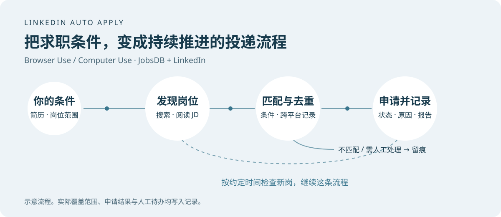
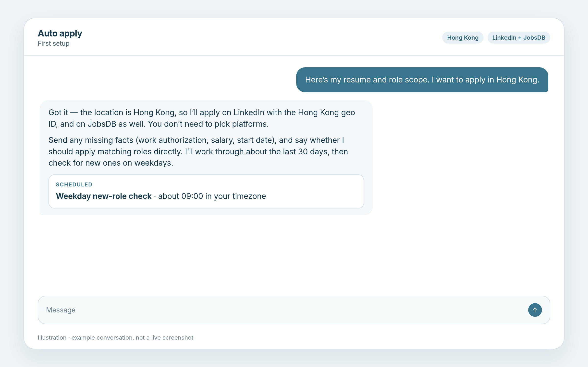
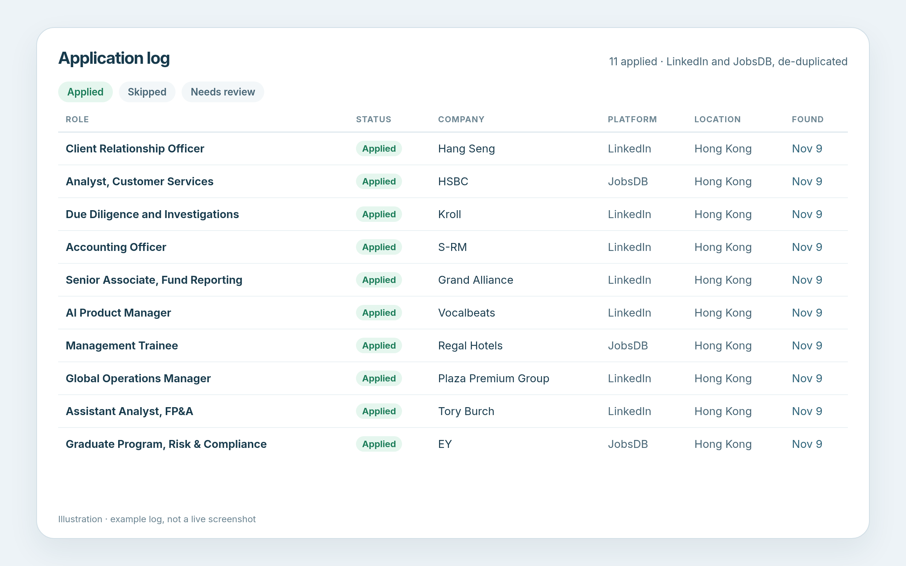
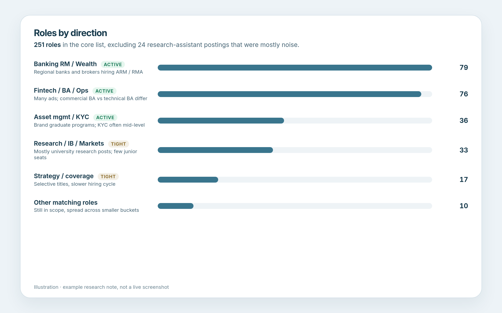

[简体中文](README.md) | [English](README_EN.md)

# linkedin-apply-for-agents

原名 `hk-auto-apply`。旧的 GitHub 地址会自动跳转到本仓库，技能名 `hk-auto-apply` 仍作为别名保留。

给个人 Agent 用的 LinkedIn 自动投递技能。

**最建议用 [Grok Bot](https://docs.x.ai/grok-bot/skills-routines-and-automations) 或 OpenAI Dots。** 它们有可 24 小时开机的云电脑，能自动跟踪投递相关邮件，也能主动每天触发并主动反馈。

其次是具备 Browser Use / Computer Use 能力的普通 Agent，例如 Codex、Claude、Cursor、Kimi。



<table>
  <tr>
    <td width="33%" align="center" valign="top">
      <strong>对话</strong><br>
      <a href="docs/images/chat.png"></a>
    </td>
    <td width="33%" align="center" valign="top">
      <strong>投递记录</strong><br>
      <a href="docs/images/records.png"></a>
    </td>
    <td width="33%" align="center" valign="top">
      <strong>岗位分析</strong><br>
      <a href="docs/images/report.png"></a>
    </td>
  </tr>
</table>

这不是 xAI、OpenAI 或 Anthropic 的官方仓库。这里没有需要单独部署的服务，也不包含任何人的简历或账号。

## 安装

在支持 Browser Use / Computer Use 的 Agent 里发送：

```text
请安装这个 GitHub 技能：https://github.com/PoetCoderJun/linkedin-apply-for-agents

请读取 START.md，并把仓库里的 skill/linkedin-apply-for-agents 完整保存到我的技能库（包括 SKILL.md、references 和 scripts，不要只复制 SKILL.md）。保存后告诉我还需要提供什么。
```

然后交一份简历，并说明投递地区和岗位范围。

## 你会得到什么

1. **存量海投**：在计划搜索范围内的目标地区岗位尽量投完；若遇平台限流会如实标出未覆盖分区，并写出分析报告和投递记录（不承诺搜齐全站）。
2. **跨平台去重**：两个平台都投时，同一公司、实质相同的岗位只投一次。
3. **每日新岗**：按你约定的时间做增量检查；有合适的就投，没有也会回一句。

投递记录和分析报告不必写成 Notion 文档。可以导出或维护为本地 Excel、Google 表格、飞书表格，或你指定的其他表格。

## 开投前请准备

Bot 只追问仍然缺少的项。不要把登录密码发给 Bot。

**文件**
- 简历（PDF 或 Word）
- 岗位范围：打字或上传选岗说明，要能读出优先、可考虑、硬性排除、软性提示

**信息**（简历或岗位范围里有的不用再给）
- 投递地区（必须，一开始就要说明）
- 该地区的工作身份或签证、期望薪资、预计可入职时间

**偏好**
- 符合要求是直接投，还是先确认名单
- 没有 Easy Apply / Quick Apply 时，默认海王模式：简单就填，复杂就跳过
- 跑在云电脑，还是你自己的电脑（选自己的电脑时，使用期间和定时任务触发时都要开机在线）
- 跟踪表放在本地 Excel、Google 表格、飞书、Notion，或你指定的其他表（没说就先给本地 Excel）
- 日常增量检查几点跑（默认工作日早上大约 9:00）

登录发生在实际使用的那台电脑上：你可以自行接管电脑登录，也可以让助手在这台电脑上走登录流程。

## 许可

[MIT](LICENSE)。与 xAI、OpenAI、Anthropic、SEEK/JobsDB、LinkedIn 无关联。
