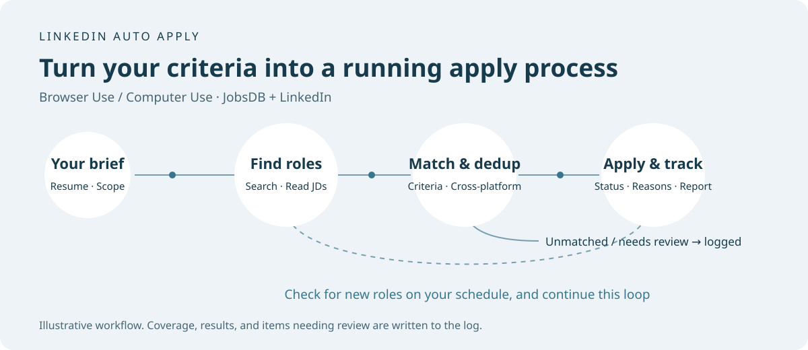
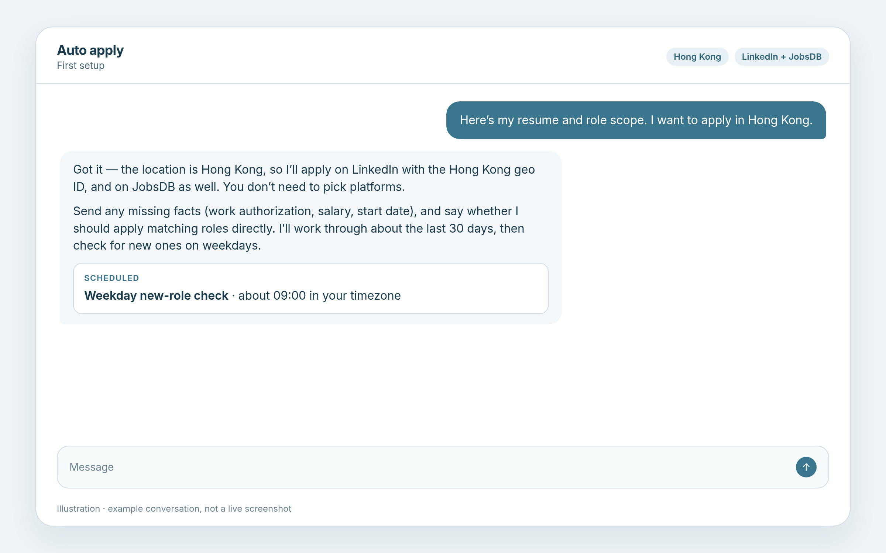
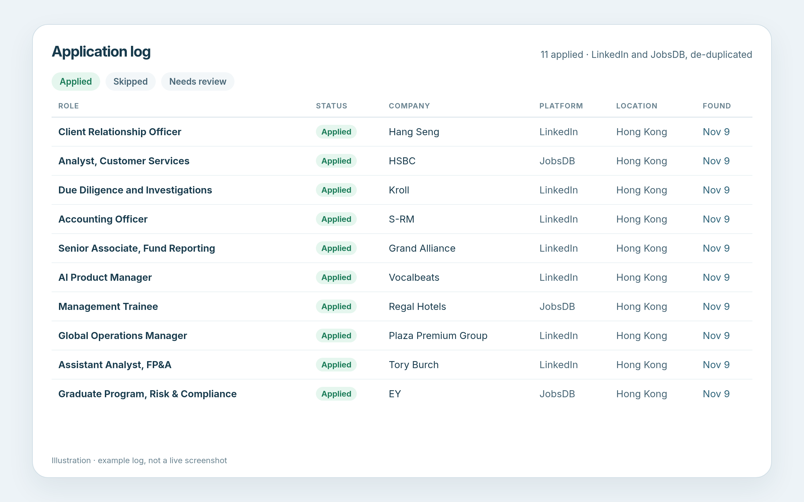
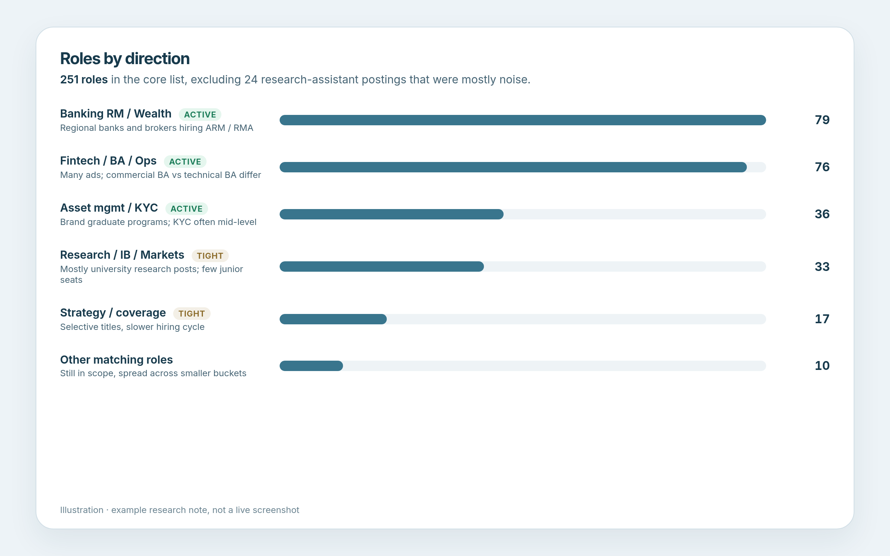

[简体中文](README.md) | [English](README_EN.md)

# linkedin-apply-for-agents

Formerly `hk-auto-apply`. The previous GitHub URL still redirects here, and `hk-auto-apply` remains a skill alias.

LinkedIn auto apply, as a skill for your personal agent.

**Best on [Grok Bot](https://docs.x.ai/grok-bot/skills-routines-and-automations) or OpenAI Dots.** They have a cloud computer that can stay on around the clock, can automatically track application-related email, and can trigger the daily check and send you updates on their own.

It also runs on ordinary agents that have Browser Use / Computer Use, such as Codex, Claude, Cursor, and Kimi.



<table>
  <tr>
    <td width="33%" align="center" valign="top">
      <strong>Conversation</strong><br>
      <a href="docs/images/chat.png"></a>
    </td>
    <td width="33%" align="center" valign="top">
      <strong>Application log</strong><br>
      <a href="docs/images/records.png"></a>
    </td>
    <td width="33%" align="center" valign="top">
      <strong>Research note</strong><br>
      <a href="docs/images/report.png"></a>
    </td>
  </tr>
</table>

This is not an official xAI, OpenAI, or Anthropic repository. There is no service to deploy, and the repo does not include anyone's resume or account.

## Install

Paste this into any agent that supports Browser Use / Computer Use:

```text
Please install this GitHub skill: https://github.com/PoetCoderJun/linkedin-apply-for-agents

Read START.md and save the entire skill/linkedin-apply-for-agents directory to my skill library (SKILL.md, references, and scripts — not SKILL.md alone). Then tell me what I still need to provide.
```

Then send a resume, name the target location, and describe or upload the role scope.

## What you get

1. **Backlog apply**: finish as many matching roles as possible in the planned search scope for your target location; if a platform rate-limits the search, the uncovered slices are marked honestly, and you get a research note plus an application log (this is not a promise of full-site coverage).
2. **Cross-platform dedup**: when both platforms are in scope, the same company and substantially the same role are applied to once.
3. **Daily new roles**: incremental checks at the time you choose; matching roles are submitted, and you still get a short update when nothing new qualifies.

The application log and research note do not have to live in Notion. You can keep or export them as a local Excel workbook, a Google Sheet, a Feishu / Lark sheet, or any other table you name.

## What to prepare

The bot only asks for whatever is still missing. Do not send login passwords.

**Files**
- Resume (PDF or Word)
- Role scope: typed text or a document that can be read as prefer / consider / hard exclude / soft flag

**Facts** (skip anything already on the resume or in the role scope)
- Target location (required at the start)
- Work status or visa for that location, expected salary, and earliest start date

**Preferences**
- Apply matching roles directly, or confirm a list first
- When a role has no Easy Apply / Quick Apply: default spray mode — fill it if it is simple, skip if it is complex
- Run on the cloud computer, or on your own computer (keep it on and online if you choose your own)
- Tracker as local Excel, Google Sheets, Feishu / Lark, Notion, or another table you name (default: local Excel)
- When the weekday check should run (default: about 09:00 in your timezone)

Sign-in happens on the computer used for the run: take it over and log in yourself, or let the assistant drive login there.

## License

[MIT](LICENSE). Not affiliated with xAI, OpenAI, Anthropic, SEEK/JobsDB, or LinkedIn.
